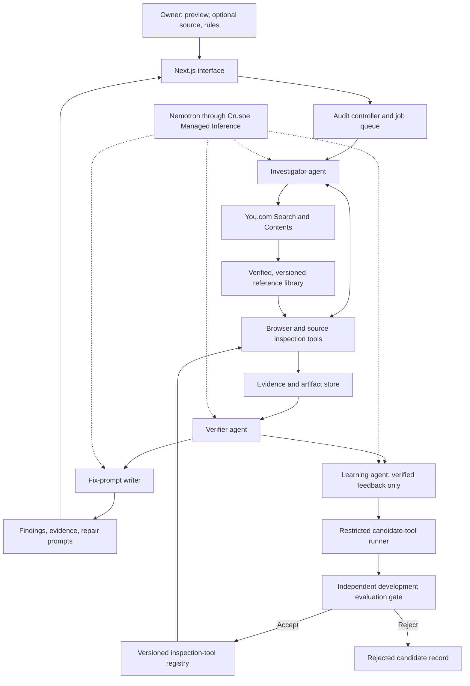

# Clueso — System Design

Status: this is the long-term architecture. The hackathon build implements the integration foundation (provider clients, bounded tool loop, browser/source inspection, asset fetching, tests) and the core agent loop described in the README: scanner, Investigator, Verifier, Fix writer, Learner (vendor research + probe synthesis), promotion gate, held-out evaluation and live UI. The build's rule packs are trackers/consent, privacy-policy disclosure and store badges; SQLite persistence and container isolation remain proposed.

Implemented follow-up: the audit pipeline now sends a single labeled reference/crop/context image to NVIDIA Nemotron 3.5 Super VL through Crusoe. Official Apple/Google reference resolution uses You.com Search/Contents plus host-controlled page/asset validation, hashes, cached raster evidence and source-byte comparison where available. Vision-only suspicions remain unresolved and never become facts in repair prompts. Google uses a public official-page example, not a downloaded asset pack.

Checker promotion now includes nine synthetic development measurement cases. A separate evaluator fingerprints the frozen brain before creating fresh synthetic apps, then compares v0 and the candidate with inference disabled and fresh browser verification. The learned background-artwork checker is active in v1; evidence and commands are described in README.md.

Last updated: October 17, 2026.

## 1. Product

Clueso is a private pre-launch auditor for AI-built websites. Agents inspect the running application against explicit brand rules, owner-supplied design requirements, and selected interaction checks. Accepted findings include evidence and repair prompts that a coding agent can execute.

The N+1 capability is learning reusable inspection tools from verified misses. An improved auditor must demonstrate the new ability on unfamiliar applications before we claim that the improvement transfers.

Customer-facing output is prompts and supporting evidence. Clueso does not automatically modify or deploy the customer's production application. Optional repair trials run only on authorized disposable copies.

### Initial checks

| Area | Checks | Evidence |
| --- | --- | --- |
| Brand assets | Approved-reference matches; aspect ratio; cropping; explicitly prohibited recoloring or transformations; minimum size and clear space where measurable and specified | Official reference, asset record, DOM instance, computed styles, rendered measurements, reproduction state |
| Design consistency | Owner-specified fonts, colors, spacing, and component rules | Versioned owner rules, source references where available, computed values |
| Interactions | Important link destinations and button behavior; keyboard reachability and focus; mobile clipping, overlap, and hidden important controls | Browser action trace, expected behavior, observed state, measurements |

"AI slop" is a product description, not an objective scoring rule. Aesthetic suggestions without an explicit owner requirement remain suggestions rather than confirmed violations.

Broad privacy/security auditing, legal certification, payments for bounties, and a public agent marketplace are outside the initial build. The first-party auditor team establishes the workflow before external agents participate.

## 2. Architecture



### Technology decisions

| Layer | Initial choice | Responsibility |
| --- | --- | --- |
| UI and application API | Next.js and TypeScript | Project submission, audit progress, evidence inspection, prompt export |
| Audit worker | Node.js and TypeScript | Long-running jobs, agent tool loop, reference collection, evaluations |
| Browser automation | Playwright | Isolated browser contexts, DOM/style inspection, screenshots, interactions |
| Persistence | SQLite | Jobs, findings, reference metadata, versions, promotion decisions, evaluations |
| Artifacts | Files outside public web paths | Screenshots, traces, reference assets, candidate code, evaluation outputs |
| Model inference | Crusoe-hosted Nemotron | Reasoning, investigation, verification guidance, prompt writing, tool proposals |
| External reference retrieval | You.com Search and Contents | Discover official pages and retrieve their contents |
| Execution isolation | Restricted containers | Submitted app previews and generated inspection-tool execution |

Start with one application server and one worker. SQLite-backed job claiming is sufficient for the initial deployment; separate storage and queue services can be introduced when concurrency requires them. Browser sessions and generated tools run outside the web server process.

OpenShell can provide the sandbox and policy boundary after host compatibility is validated. NemoClaw is an optional integration path if we adopt one of its supported agent runtimes. Neither is required by the custom agent-loop design above, and neither replaces the independent evaluator.

## 3. Crusoe and Nemotron

All four agent roles use the same pinned Nemotron deployment initially. Separate roles have separate instructions, contexts, and tool permissions; they do not require separate model deployments.

```text
Base URL: https://api.inference.crusoecloud.com/v1
Chat route: /chat/completions relative to the base URL
Candidate model: nvidia/Nemotron-3-Nano-Omni-Reasoning-30B-A3B
```

The candidate model appears in Crusoe's catalogue at the time of this design. Implementation must confirm the exact model ID and supported parameters through `GET /v1/models`, then test tool calling, streaming, reasoning output, and response parsing. Catalogue presence alone does not prove every required capability works for the account.

Keep the endpoint and model configurable. Hold the model fixed during before/after learning comparisons. The server-side model gateway validates tool arguments, records usage and latency, handles bounded retries for transient errors, and enforces per-job request/token budgets. A reasoning response with no final content is not treated as a successful agent action.

Proposed environment settings:

```text
CRUSOE_INTELLIGENCE_API_KEY (CRUSOE_API_KEY also accepted)
CRUSOE_BASE_URL
CRUSOE_MODEL
YOU_API_KEY
DATABASE_PATH
ARTIFACT_ROOT
```

Provider credentials stay in the control plane and are not placed in browser pages, generated-tool environments, evidence artifacts, or client bundles.

## 4. You.com and official references

You.com is the discovery and page-reading layer. The brand's official source is the authority.

Reference collection follows this sequence:

1. Search for the brand's official guidelines and asset download pages using You.com Search.
2. Validate the result's relationship to the brand. A search ranking or a familiar-looking logo is insufficient.
3. Retrieve relevant page contents using You.com Contents and preserve exact supporting passages with URLs.
4. Follow asset links from verified pages. A dedicated bounded fetcher retrieves the actual permitted reference files; page extraction is not a binary asset-download API.
5. Record source URL, redirect chain, retrieval time, content hash, asset variant, policy revision where available, and usage context.
6. Normalize the supported rules into explicit constraints while retaining their original references. Ambiguous requirements remain unresolved until reviewed.
7. Cache the versioned reference package. Refresh according to freshness policy; changed references require revalidation rather than silently changing an in-progress audit.

References can include third-party asset hosts linked by an official page. Record that relationship instead of assuming all valid downloads use the brand's primary domain.

A content match to an official reference establishes equivalence under the comparison method used. It does not independently prove historical origin, permission, or licensing. Do not label unresolved provenance as a fabricated violation.

## 5. Agent roles and controller

| Role | Inputs | Responsibilities | Output |
| --- | --- | --- | --- |
| Investigator | Scope, rules, tool registry, previous observations | Plan inspection, run tools, follow source-to-render relationships, identify gaps | Candidate findings and unresolved obligations |
| Verifier | Candidate evidence, applicable references, fresh browser context | Reproduce the claim, check rule applicability, identify contradictory evidence and duplicates | Confirmed, rejected, or unresolved finding |
| Fix-prompt writer | Confirmed finding and preservation requirements | Specify the targeted change, evidence, constraints, and acceptance checks | Repair prompt with explicit verification status |
| Learning agent | Verified misses, false findings, failed inspection traces, development feedback | Propose reusable adapters or playbook improvements and development tests | Versioned candidate improvement |

The controller owns job state, scheduling, evidence persistence, version pinning, budgets, repeated-action detection, and stopping decisions. It can request replanning when progress stalls. Agents cannot bypass these limits by declaring success.

The Verifier can request new observations and uses a fresh browser context where appropriate. It does not treat the Investigator's conclusion as established evidence. Agreement between two model calls is not an independent correctness oracle.

### Audit lifecycle

```text
queued -> validating_input -> collecting_references -> planning
       -> inspecting -> verifying -> writing_prompts
       -> completed | completed_with_unknowns

Any active stage may also end as failed, budget_exhausted, or needs_owner_input.
```

Scope is a recorded set of routes, interaction states, viewports, themes, and rules. Each applicable obligation is passed, violated, unresolved, or not applicable. Budget exhaustion is visible and cannot become an unconditional "ready to launch" result.

## 6. Inspection and evidence

The baseline Investigator receives ordinary browser and source-inspection primitives. We will not withhold standard capabilities to manufacture an apparent learning improvement.

Initial tools cover navigation, DOM inspection, computed styles, element geometry, asset references, relevant screenshots, keyboard actions, link checks, source search, and source reads. Source access is read-only except in a separately authorized disposable repair trial.

The core technical artifact is a source-to-render trace:

```text
Applicable rule and approved reference
-> imported or fetched asset
-> component / DOM instance
-> relevant CSS and SVG transformations
-> rendered measurements in a reproducible app state
-> supported finding and responsible code, where available
```

For supported cases, test the causal diagnosis on a disposable copy by changing only the suspected operation and measuring whether the violation disappears. Record preservation checks and the limits of the experiment. Do not claim complete causal attribution for arbitrary browser rendering.

Every finding records its project, audit version, rule/reference version, reproduction steps, evidence artifact IDs, affected element, relevant source location if established, and status. Finding validity and repair-prompt effectiveness are separate fields.

Repair status is one of `untested`, `passed_scoped_trial`, or `failed_scoped_trial`. Preview-only submissions generally cannot establish source-repair effectiveness.

## 7. Learning and tool promotion

The primary N+1 artifact is new executable inspection capability. Playbook and prompt-template changes can also be versioned, but the main demonstration must include a reusable tool improvement.

### Example

A development app renders an approved logo through a CSS mask. Existing inspection cannot reliably connect the visible mark to its asset and inherited distortion. Independent feedback establishes the missed problem. The Learning agent writes an adapter that resolves the mask, traces the relevant transformations, and returns structured evidence.

The adapter must generalize beyond that app's URLs, element IDs, component names, and selectors. It must also accept compliant uses of the same rendering technique.

### Candidate contract

Each candidate contains an ID, parent version, supported rendering pattern, input/output schemas, requested permissions, code hash, development tests, known limitations, and expected benefit. Adapters return evidence; they cannot silently alter approved rules or mark themselves correct.

### Promotion

1. Record a verified miss or failure. Unverified observations are hypotheses, not learning labels.
2. Generate a candidate change and test it in a restricted runner.
3. Compare parent and candidate on the same development evaluation set and budgets.
4. Check clean controls and existing regression cases.
5. Apply a predeclared acceptance policy: improve the targeted capability, introduce no new false accusations in protected controls, remain within regression and resource limits.
6. Record the decision and metrics. Atomically register passing versions; preserve rejected candidates for diagnosis.

Updates apply to subsequent jobs. Each active audit stays pinned to a registry snapshot so evidence remains reproducible. Review follows each audit, but an audit need not produce an accepted update.

## 8. Independent evaluation and transfer

Separate development/learning fixtures, promotion/selection fixtures, and a final untouched evaluation set. Feedback from the final set cannot drive candidate selection. Repeatedly reusing selection cases can also overfit; preserve and rotate independent evaluation material as the project grows.

Split by whole application, with different component implementations and markup. Include both faulty and clean examples, and include independently authored fixtures rather than relying exclusively on learner-generated mutations.

The evaluation oracle uses explicit labels, measurable browser assertions, known reference assets, and protected interaction checks. Hidden labels and final apps are inaccessible to the Learning agent. An LLM agreeing with a claim or an owner clicking Accept is insufficient ground truth on its own.

For the transfer demonstration, freeze V0 and V1, keep the model and ordinary tool access fixed, and run both under equal audit budgets on unfamiliar applications. App B must not be used to create or promote the adapter learned from App A.

| Metric | Purpose |
| --- | --- |
| Finding precision and recall | Detect more real issues without increasing unsupported accusations |
| False positives on clean apps | Preserve correct behavior and permitted variants |
| Correct trace / culprit identification | Establish the relevant asset and responsible transformation |
| Unresolved obligations | Show where evidence remains incomplete |
| Repair success and introduced regressions | Evaluate prompts through a fixed coding agent on disposable copies |
| Time, tool calls, tokens, and cost | Compare practical performance and disclose learning overhead |

Report actual counts and denominators. Log learning and candidate-testing cost separately from per-audit cost. A single successful transfer is an illustration; evaluation across untouched applications supports the broader improvement claim.

## 9. Data, privacy, and execution boundaries

SQLite records projects, audit scopes and runs, obligations, reference packages, evidence metadata, findings, repair prompts, tool versions, learning events, promotion decisions, evaluation runs, and usage. Large artifacts live in project-scoped files referenced by database IDs.

Each project has an owner and isolated artifact namespace. Browser sessions, source copies, and credentials are scoped to the job. Protected artifacts are served through authorized application routes.

"Private" means owner-controlled access; it does not mean all processing stays on the owner's device. Send only necessary evidence to Crusoe. You.com receives public reference searches and URLs, not private preview URLs or customer source by default.

Treat submitted source, web pages, guidelines, and downloaded assets as untrusted data rather than agent instructions. Restrict target access to owner-authorized applications and approved reference fetches. Validate URLs and redirects to prevent unintended access to host or internal services.

Generated tools and submitted app builds run outside the control plane with resource/time limits, constrained network access, and no provider keys or evaluator access. Fail closed on runner errors and preserve their diagnostic status.

Public reference packages may be reusable across projects. Customer-specific rules and code remain private. Cross-project promotion of generalized tool code requires checks for embedded customer data and project-specific assumptions; it is not automatic sharing of audit contents.

## 10. Delivery sequence

This is an implementation sequence, not a task-status tracker. Use Beads for durable task tracking if it is introduced into the repository.

| Phase | Deliverable | Acceptance evidence |
| --- | --- | --- |
| Foundation | UI/API, worker, storage schemas, configuration | A submitted job persists and reaches a recorded terminal state |
| Model connection | Crusoe/Nemotron gateway and tool loop | Verified model ID, valid tool exchange, bounded retry and usage records |
| Reference collection | You.com search/reading and official asset fetcher | Versioned reference package with URLs, supporting passages, and hashes |
| Baseline inspection | Browser/source tools and scoped rules | Reproducible observations on faulty and clean examples |
| Independent fixtures | Development, selection, and final datasets | Labels and final evaluation material inaccessible to learning agents |
| Complete audit | Investigator, Verifier, prompt writer, controller | A confirmed issue with evidence and an actionable repair prompt |
| Learning infrastructure | Restricted adapter execution and registry | Passing and failing candidates receive recorded promotion decisions |
| Transfer | A learned adapter used on unfamiliar apps | Frozen V0/V1 results with correctness and cost comparison |
| Product completion | Wider rule packs, evidence views, prompt export | Owner can complete the private submission-to-prompt workflow |

The first working milestone is one real brand-rendering issue, one independently verified diagnosis, one generated reusable inspection adapter, and one untouched application demonstrating transfer. Expand rule coverage after this chain works.

## 11. Positioning and limits

Primary hackathon track: Version N+1. Scoped completion obligations also support Done Means Done; shared versioned references and tools support Shared Brain, but require their own measurements before claiming gains.

The contribution we intend to demonstrate is agent-generated inspection adapters connecting approved assets and explicit rules to runtime evidence across unfamiliar apps. Provenance tracking, mutation testing, verified repair, and tool generation are established techniques. This design does not claim an unprecedented algorithm or universal launch certification.

The interface supports the audit workflow. Runtime inspection, evidence, and learned capabilities are the main product, rather than a screenshot scoring tool or dashboard.

## 12. References

- [Crusoe available models](https://docs.crusoecloud.com/serverless-inference/available-models/)
- [Crusoe hackathon integration reference](https://github.com/crusoecloud/crusoe-developer-hub/blob/main/examples/hackathons/crusoe-cv-recursive-agents-hackathon/crusoe-cv-recursive-agents-hackathon-skill.md)
- [You.com Search](https://you.com/docs/guides/search)
- [You.com Contents](https://you.com/docs/guides/contents)
- [NVIDIA NemoClaw and OpenShell ecosystem](https://docs.nvidia.com/nemoclaw/user-guide/openclaw/about/ecosystem)
- [Instagram official assets and guidelines](https://www.meta.com/brand/resources/instagram/instagram-brand/)
- [TypeUI audit](https://www.typeui.sh/audit)
- [Figma design-system audits](https://www.figma.com/solutions/design-system-audits/)
- [Meta Automated Compliance Hardening](https://engineering.fb.com/2025/09/30/security/llms-are-the-key-to-mutation-testing-and-better-compliance/)
- [Verified web accessibility repair research](https://arxiv.org/html/2608.24913v1)
